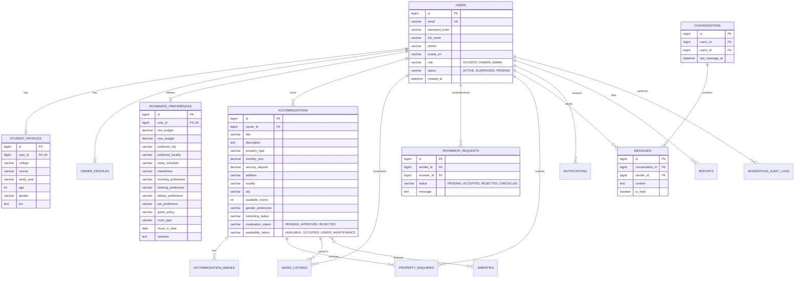

# ROOMMATE – Student Accommodation & Roommate Matching Platform

> **Academic Full-Stack Engineering Capstone Project**  
> Built with **Spring Boot 3 (Java 17)**, **React 18 + Vite**, **MySQL 8.x**, and **RESTful Stateless JWT Architecture**.

---

## 1. Project Abstract & Overview

University and college students often encounter two severe challenges when moving away from home:
1. **Finding Safe, Verified Accommodation:** Fragmented classifieds, brokers charging steep commissions, unverified landlords, and inaccurate photographs.
2. **Finding Compatible Roommates:** Conflicts over cleanliness, sleeping schedules, study environments, food habits, smoking/drinking, and financial budgets.

**ROOMMATE** solves these dual challenges by providing a unified, secure platform featuring:
- **Intelligent Roommate Matching Engine:** A true multi-dimensional weighted compatibility algorithm evaluating Budget (25%), Location (20%), Lifestyle/Schedule (20%), Personal Habits (20%), Room Type/Move-in Date (10%), and Hobbies/Interests (5%).
- **Verified Property Listings:** Multi-filter accommodation search (rent, city, property type, furnished status, amenities) with strict administrative moderation before public publishing.
- **Student-to-Student & Student-to-Owner Workflows:** Real connection requests, property visit enquiries with landlord response status, real-time threaded chat, in-app notification center, and safety grievance reporting.
- **Strict Role-Based Access Control (RBAC):** Distinct roles for **STUDENT**, **OWNER**, and **ADMIN** with zero mock data and real MySQL persistence.

---

## 2. Technology Stack

### Backend
- **Framework:** Spring Boot 3.2.5
- **Language:** Java 17
- **Security:** Spring Security 6 with Stateless JWT Authentication (`jjwt 0.12.5`) & BCrypt hashing
- **Persistence:** Spring Data JPA / Hibernate
- **Database Migrations:** Flyway (`V1__init_schema.sql`, `V2__seed_data.sql`)
- **Validation:** Jakarta Bean Validation (`hibernate-validator`)
- **Build Tool:** Apache Maven 3.9+
- **Testing:** JUnit 5, Mockito, AssertJ, In-Memory H2 Database

### Frontend
- **Framework:** React 18
- **Build Tool:** Vite 5
- **Routing:** React Router v6
- **HTTP Client:** Axios (with request & response interceptors for JWT)
- **Icons:** Lucide React
- **Design System:** Custom Responsive Vanilla CSS (Glassmorphism, curated HSL color tokens, micro-animations, zero Tailwind dependency)

### Database & Storage
- **Relational Database:** MySQL 8.0+
- **File Storage:** Local secure multipart filesystem upload with MIME/extension verification (`/uploads/**`)

---

## 3. Architecture Overview

```mermaid
graph TD
    Client["Client Browser (React 18 + Vite)"]
    
    subgraph Security Layer
        Filter["JwtAuthenticationFilter"]
        SecurityConfig["Spring Security 6 (Stateless RBAC)"]
    end
    
    subgraph REST Controllers
        AuthCtrl["AuthController (/api/v1/auth)"]
        MatchCtrl["MatchingController (/api/v1/matches)"]
        AccCtrl["AccommodationController (/api/v1/accommodations)"]
        ChatCtrl["ChatController (/api/v1/chat)"]
        ReqCtrl["RoommateRequestController (/api/v1/roommate-requests)"]
        EnqCtrl["PropertyEnquiryController (/api/v1/enquiries)"]
        AdminCtrl["AdminController (/api/v1/admin)"]
        UploadCtrl["FileUploadController (/api/v1/upload)"]
    end

    subgraph Service Layer
        MatchEngine["MatchingService (6-Dimension Weighted Algorithm)"]
        AccService["AccommodationService & Specifications"]
        ChatService["ChatService (Conversations & Threading)"]
        AuthService["AuthService (BCrypt & JWT Issuer)"]
        AdminService["AdminService (Moderation & Audit Trail)"]
    end

    subgraph Persistence Layer
        Flyway["Flyway Migration Engine"]
        MySQL[(MySQL 8 Database: roommate_db)]
        Uploads[Local Upload Directory: backend/uploads]
    end

    Client -->|Bearer JWT + HTTPS| Filter
    Filter --> SecurityConfig
    SecurityConfig --> REST Controllers
    REST Controllers --> Service Layer
    Service Layer --> Persistence Layer
```

---

## 4. Database Schema & Entity Relationship (ER) Diagram



---

## 5. Intelligent Matching Algorithm

The matching engine computes a deterministic, multi-criteria compatibility score between the logged-in student and every other student profile using normalized weights summing to **100%**:

$$\text{Total Score} = W_B S_B + W_L S_L + W_S S_S + W_H S_H + W_R S_R + W_I S_I$$

| Dimension | Weight | Mathematical Evaluation Rule |
| :--- | :---: | :--- |
| **1. Budget Compatibility** | **25%** | Evaluates overlap between budget intervals $[A_{\min}, A_{\max}]$ and $[B_{\min}, B_{\max}]$. Overlap ratio yields score; partial credit given if boundaries are within $\pm 20\%$. |
| **2. Location Alignment** | **20%** | Case-insensitive match on `preferredCity` (100% if identical, 0% if different). Bonus +10 points if `preferredLocality` also matches. |
| **3. Sleep & Daily Routine** | **20%** | Exact match in `sleepSchedule` (Early Bird / Night Owl / Flexible) = 1.0; Flexible pairing with any schedule = 0.75; Conflict (Early Bird vs. Night Owl) = 0.25. |
| **4. Habits & Lifestyle** | **20%** | Evaluates compatibility across 5 lifestyle factors (Cleanliness, Smoking, Drinking, Dietary preference, and Pets), weighted at 4% each. |
| **5. Room Type & Move-in** | **10%** | Compatibility on preferred room type (Single, Double, Shared) and move-in timeline proximity (within 30 days = 100%, 60 days = 70%). |
| **6. Shared Interests** | **5%** | Jaccard similarity index on comma-delimited hobbies/interests tags: $\frac{|A \cap B|}{|A \cup B|}$. |

Scores are mapped to intuitive compatibility tiers:
- **90% – 100%**: *Exceptional Match* (Deep lifestyle and budget harmony)
- **75% – 89%**: *High Match* (Strong compatibility with minor difference)
- **60% – 74%**: *Good Match* (Feasible co-living arrangement)
- **< 60%**: *Moderate Match* (Requires lifestyle compromise)

---

## 6. Role-Based Access Control (RBAC) Matrix

| Endpoint Group | Resource / Action | STUDENT | OWNER | ADMIN | PUBLIC |
| :--- | :--- | :---: | :---: | :---: | :---: |
| `/api/v1/auth/**` | Register, Login | Yes | Yes | — | Yes |
| `/api/v1/accommodations/search` | Search & View listings | Yes | Yes | Yes | Yes |
| `/api/v1/accommodations/{id}/save` | Bookmark accommodation | Yes | — | — | — |
| `/api/v1/accommodations` | Post / Edit accommodations | — | Yes | — | — |
| `/api/v1/matches` | Run roommate matching engine | Yes | — | — | — |
| `/api/v1/roommate-requests/**` | Send / Accept / Reject requests | Yes | — | — | — |
| `/api/v1/enquiries` | Submit enquiry to landlord | Yes | — | — | — |
| `/api/v1/enquiries/{id}/respond` | Landlord responds to enquiry | — | Yes | — | — |
| `/api/v1/chat/**` | Threaded direct messaging | Yes | Yes | Yes | — |
| `/api/v1/admin/accommodations/**` | Moderate (Approve / Reject) | — | — | Yes | — |
| `/api/v1/admin/users/**` | Suspend / Reactivate users | — | — | Yes | — |
| `/api/v1/admin/reports/**` | Investigate & Resolve safety grievances | — | — | Yes | — |
| `/api/v1/admin/audit-logs` | View tamper-evident audit logs | — | — | Yes | — |

---

## 7. Pre-Seeded Test Credentials

The database migration and `DataInitializer` pre-seed authentic accounts with password `Password@123`:

| Role | Email | Password | Pre-loaded Data |
| :--- | :--- | :--- | :--- |
| **ADMIN** | `admin@roommate.com` | `Password@123` | System oversight, moderation console |
| **OWNER** | `rajesh.verma@example.com` | `Password@123` | Multiple approved and pending properties in Delhi |
| **STUDENT** | `aarav.patel@example.com` | `Password@123` | CS student, Night Owl, ₹8,000–₹14,000 budget |
| **STUDENT** | `sneha.sharma@example.com` | `Password@123` | Architecture student, Early Bird, ₹10,000–₹16,000 budget |
| **STUDENT** | `rohan.gupta@example.com` | `Password@123` | MBA student, Flexible schedule, Delhi preferred |

---

## 8. Local Setup & Execution Instructions

### Prerequisites
- **Java Development Kit (JDK):** Version 17 or higher (`java -version`)
- **Apache Maven:** Version 3.8+ (`mvn -v`)
- **Node.js & npm:** Node 18+ and npm 9+ (`node -v`, `npm -v`)
- **MySQL Database:** MySQL 8.0+ running on port `3306`

---

### Step 1: MySQL Database Setup

1. Open your MySQL client (MySQL Workbench, HeidiSQL, or MySQL CLI):
   ```sql
   CREATE DATABASE IF NOT EXISTS roommate_db CHARACTER SET utf8mb4 COLLATE utf8mb4_unicode_ci;
   ```
2. Verify credentials in `backend/src/main/resources/application.properties`:
   ```properties
   spring.datasource.url=jdbc:mysql://localhost:3306/roommate_db?useSSL=false&serverTimezone=UTC&allowPublicKeyRetrieval=true
   spring.datasource.username=root
   spring.datasource.password=root
   ```
   *(Adjust username/password if your local MySQL root password differs).*

---

### Step 2: Start the Backend (Spring Boot)

1. Open a terminal in `d:\Ananya\RoomMate\backend`:
   ```powershell
   mvn spring-boot:run
   ```
2. Flyway will automatically execute database migrations (`V1__init_schema.sql`, `V2__seed_data.sql`).
3. The server will start on port `8080`:
   - API Base URL: `http://localhost:8080/api/v1`
   - Image Uploads Directory: `http://localhost:8080/uploads/`

To execute the automated unit and integration tests:
```powershell
mvn test
```

---

### Step 3: Start the Frontend (React + Vite)

1. Open a second terminal in `d:\Ananya\RoomMate\frontend`:
   ```powershell
   npm install
   npm run dev
   ```
2. The Vite dev server will launch at:
   - Application URL: `http://localhost:5173`

To build the optimized production distribution:
```powershell
npm run build
```

---

## 9. Academic Project Highlights & Viva Points

1. **True Functional Architecture:**
   - No mock endpoints or simulated timeouts. Every form, search, save button, moderation action, and chat message triggers a real authenticated REST API call with database persistence.
2. **Stateless Security Design:**
   - Spring Security uses stateless sessions (`SessionCreationPolicy.STATELESS`). Authentication state is validated per-request via a signed JWT bearer token verified with HMAC-SHA256 (`Keys.hmacShaKeyFor`).
3. **Defense-in-Depth File Uploads:**
   - `FileStorageService` enforces maximum 10MB file size, restricts MIME types to image types (`image/jpeg`, `image/png`, `image/webp`), generates nonces using `UUID.randomUUID()`, and strips path traversal payloads.
4. **Resilient Matching Engine:**
   - Implemented purely in Java business logic with unit test coverage (`MatchingServiceTest.java`), ensuring mathematical reliability and boundary checking.
5. **Auditable Administrative Actions:**
   - Every moderation decision and user account status change writes an immutable audit record to `moderation_audit_logs`.
